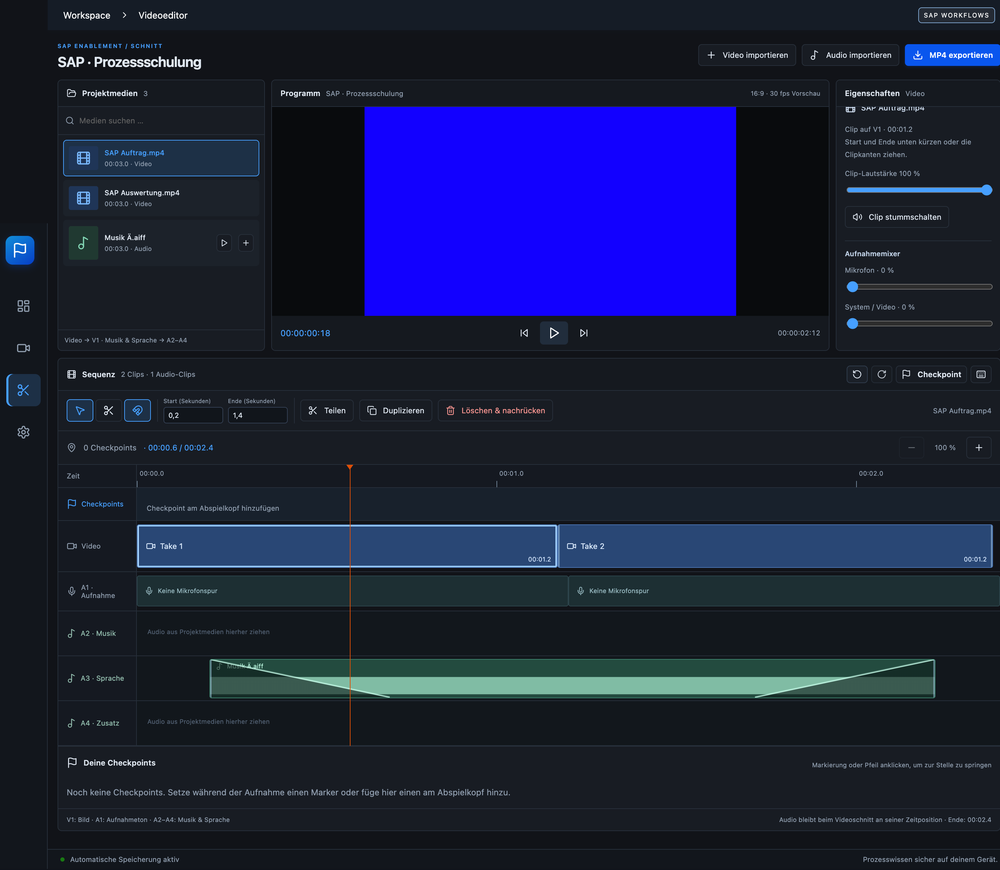

# Checkpoint Studio 0.6.0

Dunkler Bildschirmrecorder und Mehrspur-Schnittplatz für SAP-Schulungsvideos.

[Aktuelle Version für Windows und macOS herunterladen](https://github.com/xdmqxi/checkpoint-studio/releases/latest). Die Freunde benötigen den Installer aus den Releases; der Quellcode-ZIP enthält keine fertige App. [Bedienung](BEDIENUNG.md) · [Teilen und Updates](SHARING.md).




Lokale Desktop-Anwendung mit Electron, React, TypeScript und FFmpeg. Dies ist die erste Implementierungsphase des Entwicklungsauftrags, kein abgeschlossener Ersatz für OBS oder CapCut.

## Start auf macOS und Windows

Voraussetzung: Node.js 22 oder neuer und npm. Im Projektordner:

```sh
npm ci
npm start
```

`npm start` baut die Oberfläche und öffnet anschließend die Desktop-App. `npm run dev` startet nur Vite; im Browser stehen die Desktop-Funktionen nicht zur Verfügung.

macOS Apple Silicon, als DMG mit eigener Installationsansicht bauen:

```sh
npm run dist:mac
```

Ergebnis: `release/Checkpoint-Studio-0.6.0-macOS-arm64.dmg` sowie `release/mac-arm64/Checkpoint Studio.app`. DMG öffnen und die App auf den Programme-Ordner ziehen. Nur das App-Verzeichnis ohne DMG erzeugt `npm run pack:mac`. Der lokale Build ist nicht mit einem Apple Developer-ID-Zertifikat signiert oder notarisiert. Intel auf einem passenden Rechner mit `npx electron-builder --mac dir --x64` bauen; nicht hier geprüft.

Windows auf einem Windows-Rechner:

```powershell
npm ci
npm run dist:win
```

Erzeugt `release/Checkpoint-Studio-0.6.0-Windows-x64-Setup.exe`, einen NSIS-Installer mit wählbarem Installationsordner und Deinstallation. Der Windows-x64-Installer wurde auf dem Mac erfolgreich cross-kompiliert; Windows-Start/Aufnahme sind noch nicht auf einem Windows-Rechner geprüft. Siehe `WINDOWS-CHECK.md`. Native Windows-ARM64-Pakete sind noch nicht vorgesehen.

## Release-Paketierung seit 0.4

Die Pille hat eine neue dunkle Oberfläche mit hervorgehobenem Checkpoint-Button, Checkpoint-Zähler, beschrifteten Werkzeugen und klarer Pause-/Aufnahmeanzeige. Reduzierte Bewegung wird berücksichtigt. App-Icon, Windows-Icon und DMG-Hintergrund kommen aus dem eigenen Flaggen-Design.

`scripts/before-pack.cjs` bereitet FFmpeg für die Zielplattform vor, statt das Binary des Build-Rechners ungeprüft zu übernehmen. Bei Cross-Builds wird der feste Release b6.1.1 von der Quelle des bestehenden ffmpeg-static-Pakets geladen. Mach-O-/PE-Architektur, SHA-256 und Zielplattform werden geprüft; Binary, Lizenz, README und Manifest liegen im fertigen Paket unter `resources/ffmpeg` (macOS: Contents/Resources/ffmpeg). Originale und Projektformat bleiben unverändert. FFmpeg-Verkettungslisten verwenden kontrollierte relative Dateinamen, um Plattformpfade und Sonderzeichen aus der Liste herauszuhalten.

Die Pakete sind unsignierte lokale Entwicklungsreleases. Eine signierte/notarisierte öffentliche Veröffentlichung ist damit nicht vorbereitet.

```sh
npm run brand       # App-Icons und DMG-Hintergrund aus lokalem Vektordesign
npm run dist:mac    # auf diesem Mac geprüft
npm run dist:win    # x64; auch Cross-Build auf diesem Mac geprüft
```

## Erste Aufnahme

1. Aufnahme öffnen und „Quellen laden“ anklicken.
2. Unter macOS gegebenenfalls Systemeinstellungen → Datenschutz & Sicherheit → Bildschirm- & Systemaudioaufnahme freigeben. Bei Bedarf App neu starten. Mikrofonzugriff separat erlauben.
3. Bildschirm oder Fenster wählen, Qualität und Mikrofon festlegen.
4. „Aufnahme starten“ erstellt bei Bedarf einen lokalen Projektordner.
5. Aufnahme pausieren oder stoppen. Nach Stop erscheint der Take im Editor.
6. Clip auswählen, Start und Ende einstellen oder am Abspielkopf teilen. Clips durch Ziehen umsortieren. Löschen schließt die Lücke (Ripple).
7. MP4 exportieren. Der Export erzeugt echte H.264/AAC-Dateien mit 1080p30, ohne Cloud.

## Checkpoints im Videoeditor (seit 0.3)

Unter der Vorschau gibt es eine maßstabsgetreue Timeline mit Zeitlineal, eigener Checkpoint-Spur und Abspielkopf. Clipbreiten entsprechen ihrer tatsächlichen Länge. Klick auf das Lineal oder einen Marker springt zur entsprechenden Stelle, auch bei unterschiedlichen Takes und gekürzten Quellbereichen. Mit +/− lässt sich die Timeline vergrößern und horizontal scrollen.

Unter der Timeline zeigt „Deine Checkpoints“ alle Namen und Zeitangaben. Marker/Pfeil anklicken, um die Vorschau zu öffnen; Name direkt bearbeiten. Der Papierkorb entfernt nur den Marker, niemals das Video. Das ist über Rückgängig wiederherstellbar. Der Checkpoint-Button im Editor setzt den Marker am aktuellen Abspielkopf.

Neue Marker und vorhandene Marker geöffneter Projekte werden mit Take, Quellzeit und Clip verknüpft. Dadurch wandern sie beim Kürzen, Teilen oder Umordnen mit ihrem Inhalt. Wurde ihre ursprüngliche Stelle aus der Schnittfolge entfernt, bleibt der Marker als „Abschnitt entfernt“ in der Liste erhalten, ohne einen irreführenden Sprung anzubieten. Die Zeitfelder für Clips zeigen auf drei Nachkommastellen gerundete Werte.

## Während der Aufnahme: Steuerpille und Textfeld

Mit Aufnahmebeginn erscheint unten am Bildschirm eine verschiebbare Steuerpille. Sie bleibt auch bei minimiertem Studio über anderen Fenstern und unter macOS auf anderen Spaces sichtbar. Seit 0.3 setzt eine native Nachführung bei Fokus-/Fensterwechseln sowie alle 750 ms den On-top-Status und die Vordergrundposition neu, ohne den Tastaturfokus zu übernehmen. Wird die Pille während einer laufenden oder pausierten Aufnahme ausgeblendet, erscheint sie wieder. Nach Monitorwechseln wird sie in die sichtbare Arbeitsfläche zurückgesetzt. Am Griff links ziehen, um sie zu verschieben.

- **Pause / Fortsetzen** hält Video, Mikrofon und Aufnahmezeit gemeinsam an.
- **Checkpoint** setzt sofort einen Marker; der Recorder läuft weiter.
- **Zurück-Pfeil** springt in der Schnittfolge zum letzten Checkpoint zurück. Erkläre direkt weiter. Der fehlerhafte Bereich wird beim Export ausgelassen, bleibt aber im Original-Take erhalten. Der tatsächliche Computerzustand wird nicht zurückgesetzt.
- **T** öffnet das große Live-Textfeld (80 Prozent der Bildschirmbreite und -höhe). Text direkt eingeben, Schriftgröße, Fett, Ausrichtung, Text- und Flächenfarbe einstellen. Der Text wird während der Aufnahme in die Videobilder gerendert, auch bei Aufnahme eines einzelnen Fensters. Escape oder T blendet ihn wieder aus, ohne die Aufnahme zu beenden.
- **Stop** beendet und speichert die Aufnahme. Erst dann wechselt das Studio in den Editor.
- **Pfeil rechts oben** bringt das Hauptfenster zurück.

Die Pille und der Texteditor sind eigenständige native Fenster. Die Aufnahme-Engine läuft bei minimiertem Studio weiter. Die Pille erscheint während einer aktiven oder pausierten Aufnahme und verschwindet nach Stop. Während einer Pause wird neu eingegebener Text erst nach Fortsetzen ins Video geschrieben. Der Text ist im fertigen Video eingebrannt; seine Änderungen werden zusätzlich als Metadaten gespeichert, eine nachträgliche Textbearbeitung im Editor ist noch offen.

## Checkpoints und Retakes

Checkpoints können jederzeit während der Aufnahme oder Pause gesetzt werden. Ein Live-Rücksprung speichert die beibehaltenen Quellbereiche und beginnt an derselben Stelle der Schnittfolge einen neuen Bereich. Aufnahmequelle und Mikrofon werden dabei nicht neu geöffnet. Wiederholte Rücksprünge funktionieren auch über bereits verworfene Bereiche hinweg. Video und Mikrofon verwenden beim Export identische In-/Out-Zeiten.

Nach Stop bleibt die gesamte ungeschnittene Aufnahme in der Bibliothek. Durch erneutes Hinzufügen des Original-Takes lassen sich verworfene Abschnitte wiederherstellen. Undo/Redo arbeitet auf Projektzuständen; Live-Rücksprünge müssen über den Original-Take wiederhergestellt werden, da der laufende Recorder nicht durch Editor-Undo zurückgesetzt wird.

## Speicherung und Audio

Ein Projektordner enthält `project.checkpoint` (versioniertes JSON) und `media/` mit relativen Pfaden. Gesamten Ordner kopieren, um Projekte zu übertragen. Änderungen werden nach 500 ms über temporäre Datei und Umbenennen automatisch gespeichert. Videos und Mikrofon werden als getrennte WebM-Dateien gespeichert; Preview und Export mischen die separate Mikrofonspur. Importe mit eingebetteter Audiospur behalten diese beim Export.

Die Timeline hat eine geordnete Video-Clipfolge mit zugehöriger Mikrofonspur, noch keine frei belegbare professionelle Mehrspur-Timeline. Medienimporte unterstützen derzeit Videos; reine Audioimporte sind offen. Vorschau spielt den ausgewählten Clip. Beim Export wird die gesamte Clipfolge gerendert. Die Mikrofonlautstärke ist projektweit einstellbar. Wellenformen werden nicht vorgetäuscht.

## Grenzen

Nicht implementiert: Systemaudio, Webcam, Tastatur-Overlays, globale Hotkeys, KI, Transkription, Effekte, Keyframes, frei belegbare Audiospuren, Hardware-Encoding, Exportabbruch und freie Exportprofile. Die Oberfläche ist bislang Deutsch; Englisch folgt. Auflösung/FPS sind Aufnahmewünsche; Hardware und Quelle bestimmen das tatsächliche Ergebnis.

Laufende Aufnahmen werden im Speicher gesammelt. Ein Absturz vor Stop kann den laufenden Take verlieren. Lange Aufnahmen und 4K60 sind deshalb noch nicht für produktive Nutzung freigegeben. Audio und Video starten nacheinander auf derselben Recorder-Steuerung; Langzeitsynchronität ist noch nicht vermessen. Fehlende Medien erzeugen eine Fehlermeldung; Relinking ist offen.

## Architektur

- `electron/main.cjs`: lokale Dateiverwaltung, Quellenwahl, Dialoge, FFmpeg-Prozess und Export.
- `electron/preload.cjs`: kleine explizite IPC-Schnittstelle; kein Node.js im Renderer.
- `src/model.mjs`: nicht-destruktive Timeline-Operationen, Checkpoint-Rücksprung, Validierung.
- `src/main.tsx`: Hauptoberfläche und Projekt-/Live-Steuerung.
- `src/recording.ts`: Aufnahme-Lebenszyklus und gemeinsame Pausenzeit.
- `src/compositor.ts`: Live-Text direkt in die Aufnahmepixel rendern.
- `src/live-model.mjs`: Quellbereiche für unterbrechungsfreie Retakes.
- `src/text-layout.mjs`: Textumbruch für den Recorder.
- `src/checkpoints.mjs`: Quellverankerung, Positionierung und Timeline-/Quellzeit-Umrechnung.
- `src/EditorTimeline.tsx`: maßstabsgetreue Timeline und navigierbare Checkpoint-Liste.
- `src/Floating.tsx`, `electron/floating.cjs`: native Steuerpille und Texteditor über eine begrenzte IPC-Schnittstelle.
- `src/style.css`: Designsystem, dunkles und helles Farbschema.
- `tests/`: Modelltests, echter FFmpeg-Integrationstest, Electron-UI-Smoke-Test.

Die Capture-Abstraktion nutzt zurzeit Chromium/Electron desktopCapturer und MediaRecorder. Separate direkte ScreenCaptureKit-/Windows-Capture-Adapter in Swift/Rust/C++ sind eine spätere Phase. Medienverarbeitung läuft außerhalb des Renderers im FFmpeg-Unterprozess. Die Recording-Engine muss vor langen Produktionsaufnahmen auf fortlaufend geschriebene Segmente umgestellt werden.

## Prüfungen

```sh
npm run build
npm test
node tests/ui-smoke.mjs
npm run test:live
npm run test:editor
# Nach dist:mac auch das gepackte App testen:
node tests/live-controls-smoke.mjs --packaged
node tests/editor-checkpoints-smoke.mjs --packaged
# Mit CHECKPOINT_APP_PATH kann auch eine App direkt aus gemounteter DMG getestet werden.
npm audit
```

Siehe `VALIDATION.md` für den tatsächlich geprüften Stand. Vor Weitergabe `THIRD_PARTY.md` lesen.

Technische Referenz: [Electron desktopCapturer](https://www.electronjs.org/docs/latest/api/desktop-capturer).

Referenz für Always-on-top-/Spaces-Fenster: [Electron BaseWindow](https://www.electronjs.org/docs/latest/api/base-window). Die schwebenden Fenster fordern Capture-Ausschluss über Content Protection an; ob das Betriebssystem die Pille bei einer gesamten Bildschirmaufnahme ausblendet, ist plattformabhängig und nicht zugesichert. Die Sichtbarkeit des Live-Texts im Video hängt davon nicht ab: Er wird im eigenen Compositor gerendert.

Seit 0.4.1 wird die Breite der Steuerpille aus den tatsächlichen Bedienelementen gemessen und das native Fenster entsprechend angepasst. Der leere Nachlauf rechts entfällt.

Seit 0.4.2 gibt es direkt in der Timeline-Leiste einen kleinen Scheren-Button neben Rückgängig. Position auf der Zeitskala wählen und die Schere anklicken, um den Clip dort zu teilen.

Seit 0.4.3 sind Start/Ende, Teilen, Duplizieren und Löschen & nachrücken gemeinsam unter dem Timeline-Kopf angeordnet. Rechts bleibt der Audiomixer.

Seit 0.4.4: Audio importieren (MP3, WAV, M4A, FLAC, OGG, AAC, AIFF). Einfügung am Abspielkopf; Position und Lautstärke unten unter Audio & Musik einstellen. Audiospuren bleiben unabhängig von Videoschnitten an ihrer Timeline-Position und werden bis zum Videoende exportiert.

## SAP-Workflow-Design (0.5.0)

Oberfläche an SAP Fiori Horizon angelehnt: dunkle Karten, blaue Aktionen, klare Shell-Leiste, blaue Timeline und passende Aufnahme-Pille. Dunkles Design ist Standard; Einstellungen bieten weiterhin eine helle Variante. Eigene Checkpoint-Flaggenmarke bleibt bestehen; keine SAP-Anbindung oder offizielle SAP-Herausgeberschaft wird hinzugefügt.

## Schnittplatz 0.6

Dunkler Schnittplatz mit Projektmedien, Programmvorschau, Eigenschaften und gemeinsamer Mehrspur-Timeline. Video und Audio schneiden, an den Kanten kürzen, verschieben, duplizieren, stummschalten; Wellenformen, Audio-Fades, Rasierklinge, Einrasten und Tastenkürzel. Wiedergabe über Clipgrenzen hinweg; normalisierte Audio-/Videoimporte und konfigurierbarer MP4-Export. Die vollständige Bedienung und Grenzen stehen in [BEDIENUNG.md](BEDIENUNG.md). UI-End-to-End-Test: `npm run test:studio`.
